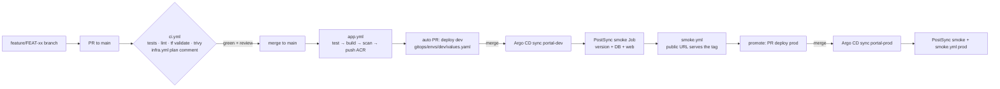

# End-to-end feature flow — from a feature branch to production

This is the **real E2E**: every simulated ticket below goes from a feature branch to production through the same gates a client team would use. Nothing is applied by hand; every change is a commit.



| Gate | Where | What proves it passed |
|---|---|---|
| Code quality | `ci.yml` on the PR | green checks: `app` (npm test), `helm`, `terraform *`, `trivy` |
| Infra impact | `infra.yml` on the PR | PR comment `Plan: x to add, y to change, 0 to destroy` |
| Artifact | `app.yml` on main | image `customer-portal-api:<sha>` in ACR, Trivy passed |
| Deploy dev | merge of the auto PR | Argo CD `portal-dev` Synced/Healthy |
| Verify dev | PostSync Job + `smoke.yml` | Job log `SMOKE OK version=<sha>`; workflow summary "✅ dev serves <sha>" |
| Promote | `app.yml` → *promote_to_prod* | PR `deploy(prod)` reviewed with the dev evidence |
| Verify prod | PostSync Job + `smoke.yml` | same evidence for prod |

## One-time setup (after phases 00–08 of the lab)

1. Platform up: `./scripts/azp.ps1 up -Through 40-aks`, `./scripts/bootstrap-gitops.ps1`, `./scripts/sql-grant-app-identity.ps1` (labs 01–07).
2. Repository variables from lab 02 (`AZURE_CLIENT_ID`, `ACR_NAME`, …). Without them `app.yml` and `infra.yml` skip on purpose.
3. **Public URLs** for `smoke.yml` (after lab 10, edge layer):
   ```powershell
   gh variable set PORTAL_DEV_URL  -b https://portal-dev.edymonte.com.br
   gh variable set PORTAL_PROD_URL -b https://portal.edymonte.com.br
   ```
   Without the edge layer, the in-cluster PostSync Job is your verification and `smoke.yml` skips.
4. **Branch protection on `main`** (already applied; requires a public repo or a paid plan):
   - pull request required (0 approvals — a solo learner cannot approve their own PR), conversations resolved;
   - all 12 CI checks required (`app`, `helm`, `trivy (…)`, `terraform <layer>` × 9);
   - linear history (squash merges), no force pushes, no deletions;
   - **enforced for admins** — no direct pushes, not even by you.

   Inspect it: `gh api repos/edymonte/azure-enterprise-platform/branches/main/protection`.
   **Break-glass** (CI itself is broken and blocks the fix): `gh api -X DELETE repos/edymonte/azure-enterprise-platform/branches/main/protection/enforce_admins`, merge the fix, then re-enable with `-X POST` on the same path. Treat it like a production incident: write down why.

   **Deploy PRs and required checks:** PRs opened by `app.yml` with the default `GITHUB_TOKEN` do **not** trigger workflows, so their required checks would never report. Create a fine-grained PAT (this repo only; *Contents: read/write*, *Pull requests: read/write*) and store it:
   ```powershell
   gh secret set GITOPS_PR_TOKEN -R edymonte/azure-enterprise-platform
   ```
   The workflow uses it automatically (`secrets.GITOPS_PR_TOKEN || github.token`).
5. Argo CD UI open while you work: `kubectl -n argocd port-forward svc/argocd-server 8080:80`.

## The standard loop (memorize it — it is your interview answer)

```powershell
git switch main; git pull
git switch -c feature/FEAT-01-product-by-id
# ... change code + tests ...
npm --prefix app/customer-portal/api test
git commit -am "feat(api): FEAT-01 get product by id"
git push -u origin HEAD
gh pr create --fill            # template asks for verification + rollback plan
gh pr checks --watch           # wait for green
gh pr merge --squash --delete-branch
gh run watch                   # app.yml: build → scan → push → opens the deploy PR
gh pr list --search "deploy(dev)"; gh pr merge <n> --squash --delete-branch
# Argo CD syncs portal-dev → PostSync smoke Job → smoke.yml (if edge is up)
kubectl -n portal-dev logs job/customer-portal-smoke
gh workflow run app.yml -f promote_to_prod=true        # opens deploy(prod) PR
gh pr merge <n> --squash --delete-branch
kubectl -n portal-prod logs job/customer-portal-smoke
```

## Simulated tickets

Do them in order; each one exercises a different path. Write the evidence in the PR description.

### FEAT-01 — New endpoint (happy path, dev → prod)
> *"Customer service needs `GET /api/products/:id`. Unknown ids must return 404."*

- Branch `feature/FEAT-01-product-by-id`. Add the route in `app.js` + `db.js` (`SELECT ... WHERE id = @id` / in-memory find) and two tests (found, 404).
- **Done when:** both PostSync jobs log `SMOKE OK version=<sha>`; `curl https://portal.edymonte.com.br/api/products/2` returns one product in prod.

### FEAT-02 — UI change (both images)
> *"Show the number of products in the page title."*

- Branch `feature/FEAT-02-product-count`, edit `web/index.html`.
- Observe: `app.yml` rebuilds **both** images with the same tag. **Interview hook:** "how would you build only what changed?" (path filters per component / matrix).
- **Done when:** the page in dev shows the count, then prod after promotion.

### FEAT-03 — Bug caught before main
> *"Refactor the product mapping."* (introduce a bug on purpose: return `title` instead of `name`)

- Update the code **but not the test** → push → `ci.yml` fails on `app`. Branch protection blocks the merge.
- Fix, push again, green, merge.
- **Done when:** the PR shows one red and one green run; nothing reached ACR from the red commit.

### FEAT-04 — Bad release caught in dev
> *"Add a `featured` column to products."* (unit tests pass — in-memory mode — but the SQL is wrong)

- Change the SQL to select a column that does not exist; tests stay green; merge; deploy PR to dev.
- **Observe:** pods become `Ready`? (`/readyz` only pings the DB) → yes. **PostSync smoke fails** on `/api/products` → Argo CD sync `Failed`; `smoke.yml` dev fails.
- Do **not** promote. Roll back: `git revert` of the deploy PR (dev returns to the previous tag) **and** fix forward on a new branch.
- **Done when:** you can explain why unit tests passed but the smoke test failed (test pyramid: unit vs integration vs smoke) and propose the missing integration test.

### FEAT-05 — Infrastructure change with approval
> *"QA needs its own environment `portal-qa`."*

- Branch `infra/FEAT-05-qa-namespace`: `portal-qa` in `40-aks` `local.portal_namespaces`, `gitops/apps/portal-qa.yaml`, `gitops/envs/qa/*.yaml`, `qa` in `render-gitops-values.ps1`.
- PR → `infra.yml` comments `40-aks — Plan: 1 to add, 0 to change, 0 to destroy`. **Read it before merging.**
- Merge → *Actions → infra → Run workflow* `layer=40-aks action=apply` → **approve** in the `lab` environment → Argo CD creates `portal-qa`.
- **Done when:** the plan comment, the approval record and the Healthy `portal-qa` app are all visible.

### FEAT-06 — Production hotfix
> *"P1: prod banner shows the wrong text after a secret change; marketing needs it fixed now."* (or reuse FEAT-04's bug if it reached prod)

- Decide first: **config fix** (Key Vault secret, no deploy — CSI rotates in 2 min) or **code fix** (hotfix branch → same pipeline → promote the **same image** that passed dev). Never build a different artifact for prod.
- **Done when:** you can state the time to restore and why "build once, deploy many" mattered.

### FEAT-07 — Rollback drill
> *"Release <sha> increased p95 latency."* (inject `chaos.latencyMs: "800"` through a deploy PR to prod)

- Detect it (alert e-mail / Grafana p95 panel), then roll back with **`git revert`** of the deploy PR — not `kubectl rollout undo` (Argo CD would re-apply Git anyway).
- **Done when:** p95 back to normal and the revert commit is the audit trail.

### FEAT-08 — Same feature through Azure DevOps
> *"The client's other team uses Azure DevOps."*

- Repeat FEAT-02 (a small UI change) but let `pipelines/azure-devops/app.yml` build and open the deploy PR (lab 09).
- **Done when:** you can compare both runs side by side: triggers, identity (OIDC vs WIF service connection), approvals, artifact, deploy PR.

## Release evidence (copy into each deploy PR)

```markdown
- Commit / image tag: `<sha>`
- CI run: <link>  ·  App pipeline run: <link>
- Trivy: no CRITICAL
- Argo CD portal-dev: Synced/Healthy at <time>
- PostSync smoke dev: `SMOKE OK version=<sha>`
- smoke.yml dev: ✅ (or skipped: edge down)
- Rollback: revert this PR
```

## How to tell it in an interview (60 seconds)

> "A developer opens a PR from a feature branch; CI runs unit tests, Helm lint, Terraform validate and a Trivy scan, and infra changes get a plan comment. After merge, the app pipeline builds once, scans, pushes an immutable tag and opens a deploy PR on the GitOps folder for dev. Argo CD syncs, a PostSync job checks that the new version is live and the database path works, and an external smoke test confirms the public URL. Promotion to prod is another PR with the same image, so prod runs exactly what was tested. Rollback is a git revert. The pipeline never has cluster credentials."
