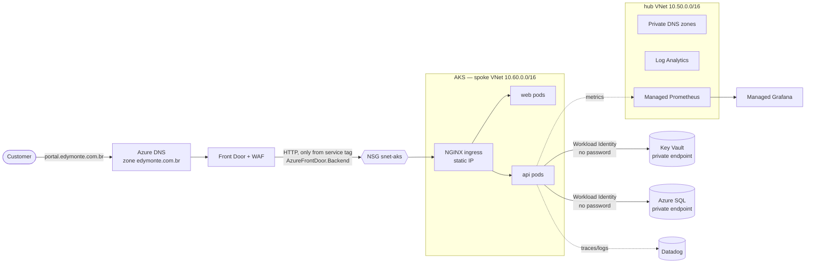
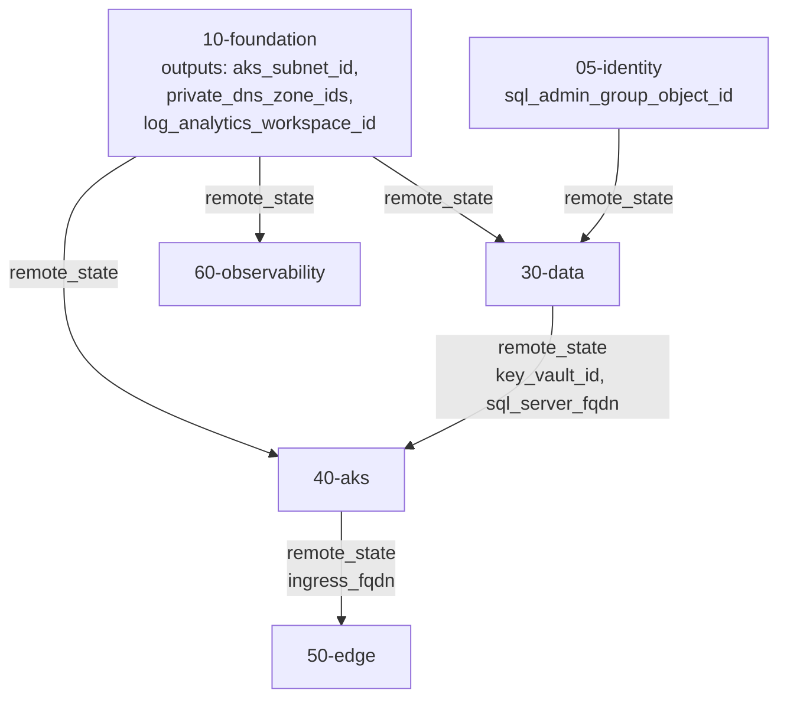
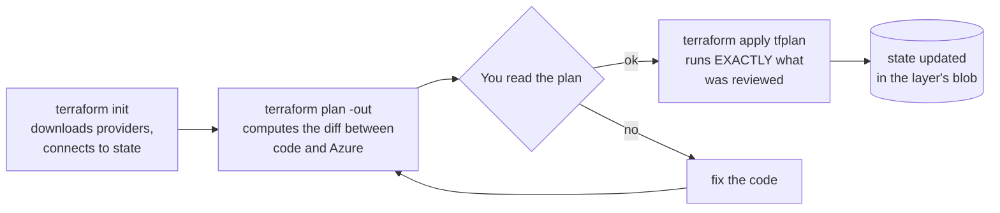
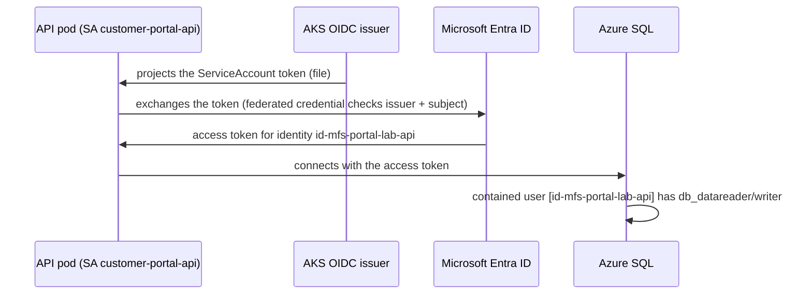
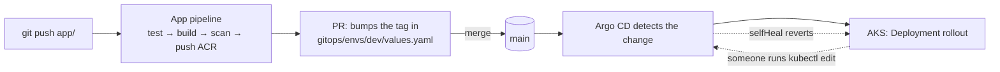

# How this environment works

> Read this **before** your first `terraform apply`. It explains what gets built, why it is split the way it is, and how the pieces talk to each other. The labs (`docs/labs/`) are the *how-to*; this document is the *how it works*.

---

## 1. The story

You are the platform engineer at **Monteiro Financial Services (MFS)**. The company wants its **Customer Portal** on Azure, with production requirements:

| # | Business requirement | How the platform meets it |
|---|---|---|
| 1 | Portal online with its own domain, HTTPS and protection against web attacks | Public DNS + Front Door + WAF (`50-edge`) |
| 2 | No database or secret exposed to the internet | Private Endpoints + Key Vault + Workload Identity (`30-data`, `40-aks`) |
| 3 | No manual access to the cluster to deploy | GitOps with Argo CD + pipelines that only open PRs (`gitops/`, `.github/`, `pipelines/`) |
| 4 | Auditable compliance | Azure Policy + Defender for Cloud (`20-governance`) |
| 5 | Operations finds problems before customers do | Prometheus/Grafana + Datadog, SLO-based alerts (`40-aks`, `60`, `70`) |
| 6 | A tested contingency plan | Traffic Manager DR lab + game days (`50-edge`, `docs/game-days.md`) |
| 7 | Delivery through GitHub **and** Azure DevOps | Equivalent pipelines in both tools |

Everything is created with **Terraform**. There are only three imperative (non-Terraform) steps, each with a documented reason:

1. installing Argo CD once (`bootstrap-gitops.ps1`) — from then on, Git drives the cluster;
2. creating the application user inside the SQL database (`sql-grant-app-identity.ps1`) — database DDL is not an Azure resource;
3. writing secret **values** into Key Vault (`az keyvault secret set`) — **a secret never enters Terraform state**.

---

## 2. The big picture



Read it like this: **Front Door is the only way in**. AKS accepts HTTP only from Front Door IPs (NSG rule). The API talks to the database and the secret store over **private addresses**, using a **managed identity** — there is no password anywhere.

---

## 3. Why is Terraform split into layers?

Instead of one giant `main.tf`, the infrastructure is split into numbered **layers**. Each layer is an independent Terraform root module with **its own state file**.

```text
infra/terraform/
├── 00-bootstrap      LOCAL state   → state storage, DNS zone, budget                 (lives for the whole lab)
├── 05-identity       remote state  → pipeline identities (OIDC), SQL admin group     (lives for the whole lab)
├── 10-foundation     remote state  → hub/spoke network, private DNS, Log Analytics   ┐
├── 20-governance     remote state  → Azure Policy, Defender                          │
├── 30-data           remote state  → Key Vault, Azure SQL (private endpoints)        │ up and down
├── 40-aks            remote state  → AKS, ACR, identities, metrics collection        │ every day
├── 50-edge           remote state  → Front Door, WAF, DNS records, Traffic Manager   │ (cost)
├── 60-observability  remote state  → Managed Grafana                                 │
└── 70-datadog        remote state  → Datadog monitors, SLO, dashboard                ┘
```

**Why is this better than a single root module?**

| Reason | In practice |
|---|---|
| **Smaller blast radius** | A mistake in `50-edge` cannot destroy the database in `30-data`: its `plan` does not even see those resources. |
| **Cost control** | Front Door Premium is expensive: apply `50-edge` only during the edge phase and destroy it afterwards, without touching anything else. |
| **Speed** | Planning a layer with 20 resources takes seconds; one with 200 takes minutes. |
| **Ownership** | In a company, network, security and application teams own different layers with different permissions. |
| **Explicit order** | The number tells you the dependency. Nobody has to guess what comes first. |

### How does one layer talk to another?

Through **`terraform_remote_state`**. The lower layer publishes `outputs`; the upper layer reads them straight from the remote state.



Real example, from `infra/terraform/40-aks/remote-state.tf`:

```hcl
data "terraform_remote_state" "foundation" {
  backend = "azurerm"
  config = {
    resource_group_name  = var.state_resource_group_name
    storage_account_name = var.state_storage_account_name
    container_name       = "tfstate"
    key                  = "10-foundation.tfstate"   # ← the network layer's state
    use_azuread_auth     = true
  }
}
```

And how it is used, in `40-aks/main.tf`:

```hcl
locals {
  foundation = data.terraform_remote_state.foundation.outputs
}

default_node_pool {
  vnet_subnet_id = local.foundation.aks_subnet_id   # ← subnet created by layer 10
}
```

> 💡 **Interview angle:** "Remote state couples layers through an *output contract*. If the network layer renames an output, the AKS layer breaks at `plan` time — not in production." The common alternative is a `data "azurerm_subnet"` lookup by name. Remote state is more explicit; data sources couple less. This lab uses remote state so you can *see* the contract.

---

## 4. Anatomy of a layer

Every layer has the same file layout. Learn one, understand all:

| File | Purpose | Example |
|---|---|---|
| `versions.tf` | Terraform and provider versions. Everyone (you, GitHub, Azure DevOps) runs the same thing. | `azurerm ~> 4.40` |
| `backend.tf` | *Where* state lives. **Empty on purpose** (partial configuration): the storage is injected at `init`. | `backend "azurerm" {}` |
| `remote-state.tf` | Reads outputs from earlier layers. | `data "terraform_remote_state" "foundation"` |
| `main.tf` | The resources, with comments explaining *why*. | `azurerm_kubernetes_cluster` |
| `variables.tf` | Inputs with sensible defaults and `validation` where a mistake would be expensive. | `operator_ip_ranges` rejects `0.0.0.0/0` |
| `outputs.tf` | The contract published to later layers and to the scripts. | `ingress_fqdn` |

### Why is `backend.tf` empty?

```hcl
terraform {
  backend "azurerm" {}
}
```

The storage account name has a random suffix (created by `00-bootstrap`), and each layer uses a different **key**. Instead of repeating that in 8 files, `init` receives the configuration from outside:

```powershell
terraform -chdir=infra/terraform/10-foundation init `
  -backend-config=.runtime/backend.hcl `        # storage, container, Entra ID auth
  -backend-config=key=10-foundation.tfstate     # one blob per layer
```

That is exactly what `scripts/azp.ps1` does — and it **prints every command** before running it, so you learn it and can repeat it by hand.

---

## 5. The command cycle (the heart of Terraform)



Rules the whole lab follows (and interviews ask about):

1. **`plan -out` + `apply <file>`** — what gets applied is what was reviewed. No surprises between plan and apply.
2. **Read the summary `Plan: X to add, Y to change, Z to destroy`.** An unexpected `destroy` is your signal to stop.
3. **`-/+` means replace.** For a database or a cluster, that is an incident. Understand why before applying.
4. **Nobody edits state by hand.** To move or rename resources use `moved {}`, `terraform state mv` or `import {}`.

The script wraps this into short commands:

```powershell
./scripts/azp.ps1 plan  10-foundation     # init + plan
./scripts/azp.ps1 apply 10-foundation     # init + plan + confirmation + apply
./scripts/azp.ps1 up -Through 40-aks      # applies 05 → 40 in order
./scripts/azp.ps1 down                    # destroys 70 → 10 in reverse order
./scripts/azp.ps1 status                  # which layers currently have resources
```

### The two generated files in `.runtime/` (not in Git)

| File | Content | Why outside Git |
|---|---|---|
| `.runtime/backend.hcl` | Where state lives | Contains your storage account name |
| `.runtime/common.tfvars.json` | Variables shared by every layer (subscription, e-mail, your IP) | Personal data |

In the pipelines the same content is generated from GitHub / Azure DevOps variables (`scripts/ci-write-runtime.sh`).

---

## 6. Layer by layer

Each layer teaches **Azure concepts** and **Terraform techniques**. This table is your map:

| Layer | Creates | Terraform technique you practice | Azure concept |
|---|---|---|---|
| `00-bootstrap` | State storage, DNS zone, budget | **local** state (chicken-and-egg), `random_string`, conditional `count`, `lifecycle.ignore_changes` | Remote state with Entra ID (no access keys), Budgets |
| `05-identity` | Entra apps with OIDC federation, RBAC, SQL group | `azuread` provider, `for_each` over a map, `setproduct` to build (identity × role) pairs | Workload identity federation, least privilege |
| `10-foundation` | Hub/spoke, peering, NSG, private DNS, Log Analytics, Prometheus | `cidrsubnet()` for IP planning, `for_each` over `toset`, `validation` | Hub & spoke, service tags, private DNS |
| `20-governance` | Custom policies, initiative, Defender | `file()` + `jsonencode()` (policy as code), initiative parameters | Azure Policy (Audit→Deny), Defender for Cloud |
| `30-data` | Key Vault, SQL, private endpoints | `remote_state` from 2 layers, temporary resource via conditional `for_each` | Private Endpoint, Entra-only SQL, PITR |
| `40-aks` | AKS, ACR, static IP, API identity, DCRs, PromQL alerts | `dynamic` blocks, heredocs, `lifecycle`, many `role_assignment`s | Workload Identity, CNI Overlay + Cilium, add-ons |
| `50-edge` | Front Door, WAF, domains, certificates, Traffic Manager | `for_each` over a map of hosts, explicit `depends_on`, `dynamic` inside `dynamic` | Front Door vs Traffic Manager, WAF Detection→Prevention |
| `60-observability` | Managed Grafana | role assignments for a managed identity | Grafana + Azure Monitor workspace |
| `70-datadog` | Monitors, SLO, dashboard | **another provider** (Datadog), `templatefile()` | Monitoring as code, SLO / error budget |

### How to read a Terraform resource (annotated example)

```hcl
resource "azurerm_federated_identity_credential" "portal_api" {   # type  +  local name
  for_each  = toset(local.portal_namespaces)                         # one credential per namespace (dev, prod)
  name      = "fic-${each.value}"
  parent_id = azurerm_user_assigned_identity.portal_api.id           # a reference = implicit dependency
  issuer    = azurerm_kubernetes_cluster.this.oidc_issuer_url        # AKS "signs" the tokens
  subject   = "system:serviceaccount:${each.value}:customer-portal-api"  # ONLY this SA can exchange tokens
  audience  = ["api://AzureADTokenExchange"]
}
```

Three ideas in this block:

- **`for_each`** creates one instance per item, addressed by key (`...portal_api["portal-dev"]`). Unlike `count`, removing an item in the middle does not renumber the others.
- **References** (`azurerm_kubernetes_cluster.this.oidc_issuer_url`) define creation order by themselves. `depends_on` is only needed when the dependency is not visible in the code — like the CNAME in `50-edge`.
- The **`subject`** is the security boundary: a pod with a different ServiceAccount, or in another namespace, cannot impersonate the API.

---

## 7. The four flows you must be able to explain

### 7.1 Request flow (network)

```text
Browser
  → Public DNS: portal.edymonte.com.br  CNAME → fde-....azurefd.net          (50-edge)
  → Front Door: TLS terminates here (managed certificate) + WAF evaluates    (50-edge)
  → origin: pip-...-ingress.eastus2.cloudapp.azure.com:80, Host preserved   (40-aks)
  → NSG on snet-aks: allows only "AzureFrontDoor.Backend" on 80/443         (10-foundation)
  → NGINX ingress (portal-nginx) routes by host + path: /api → api, / → web (gitops)
  → NetworkPolicy: pods accept traffic only from the ingress namespace     (gitops chart)
  → API → SQL: sql-....database.windows.net resolves to 10.60.8.x          (private DNS, 10 + 30)
```

### 7.2 Identity flow (why there is no password)



The same pattern authenticates the **pipelines** to Azure: GitHub / Azure DevOps issue an OIDC token, and Entra checks issuer and subject against the federated credential created by `05-identity`. **Zero client secrets in the whole project.**

### 7.3 Delivery flow (GitOps)



The pipeline **has no cluster credentials**. It can only push to ACR and open a PR. Argo CD applies the change from inside the cluster. Promoting to production is another PR (`envs/prod/values.yaml`). Rollback is `git revert`.

### 7.4 Observability flow (two stacks, on purpose)

| Signal | Azure-native stack | Datadog stack |
|---|---|---|
| App metrics | `/metrics` → Managed Prometheus (PodMonitor) → Grafana | APM trace metrics |
| Traces | — | `dd-trace` → Datadog APM |
| Logs | Container Insights → Log Analytics (KQL) | Datadog Logs |
| Alerts | Prometheus rule group (`40-aks`) → Action Group | Monitors (`70-datadog`) |
| Dashboards | Versioned JSON → `grafana-import.ps1` | `datadog_dashboard_json` (Terraform) |
| SLO | Availability PromQL | `datadog_service_level_objective` |

Many companies run both: the native stack (cheap, already integrated) for the platform, and Datadog (APM, correlation) for applications. Being able to **compare** them is what matters in an interview (ADR-0006).

---

## 8. Where are the secrets? (short answer: nowhere in Git)

| Item | Where it lives | How it reaches the consumer |
|---|---|---|
| Pipeline access to Azure | No secret exists: OIDC | federated credential (`05-identity`) |
| API access to SQL / Key Vault | No secret exists: Workload Identity | federated credential (`40-aks`) |
| Banner message (sample secret) | Key Vault | CSI driver mounts it as a file, rotated every 2 min |
| Datadog API key | Key Vault | `datadog-secret.ps1` → Secret in namespace `datadog` |
| GitHub token (ADO pipeline) | Key Vault | ADO variable group linked to Key Vault |
| Terraform state | Versioned blob, Entra ID access only | — |

---

## 9. Daily cycle and cost

The environment is designed to **come up in the morning and go down at night**:

```powershell
./scripts/azp.ps1 up -Through 40-aks     # ~20–25 min (AKS is the slowest)
./scripts/bootstrap-gitops.ps1           # ~5 min
# ... study ...
./scripts/azp.ps1 down                   # ~15 min
```

What **stays** overnight (cheap): `00-bootstrap` (state, DNS zone, budget) and `05-identity` (identities — free).

See `docs/costs.md` for the per-layer estimate and the trial pitfalls.

---

## 10. Quick glossary

| Term | Meaning here |
|---|---|
| **State** | Terraform's "database": what it created and with which IDs. One blob per layer. |
| **Partial backend** | An empty `backend "azurerm" {}`, completed at `init` with `-backend-config`. |
| **Remote state** | One layer reading another layer's outputs. |
| **Hub & spoke** | A central VNet (shared services) + workload VNets connected through peering. |
| **Private Endpoint** | A NIC in your VNet that represents a PaaS service (SQL, Key Vault). |
| **Workload Identity** | A pod authenticates to Entra ID by exchanging its ServiceAccount token — no secret. |
| **OIDC federation** | Same principle, for pipelines (GitHub / ADO → Entra). |
| **GitOps** | The desired cluster state lives in Git; an agent (Argo CD) converges the cluster to it. |
| **App-of-apps** | One Argo CD Application that creates the other Applications. |
| **Initiative** | A set of policies assigned together, with a single compliance score. |
| **SLO / error budget** | A reliability target (e.g. 99.5% over 7 days) and how much failure still fits in it. |
