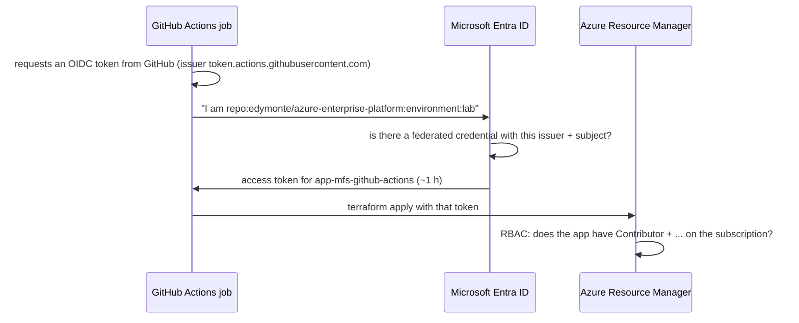

# Phase 02 — Identities and OIDC, no secrets (3 h)

## 🎯 Goal

Create **with Terraform** the identities that pipelines (GitHub Actions now, Azure DevOps later) use to change Azure — **without any client secret** — plus the group that administers Azure SQL.

## 🧠 Concepts



- **Authentication** (who are you?) = federated credential: issuer + **subject** + audience.
- **Authorization** (what may you do?) = Azure RBAC (`azurerm_role_assignment`).

When a pipeline fails, the first question is always: **did authentication or authorization fail?** (`AADSTS…` = authentication; `AuthorizationFailed` = RBAC.)

## 🛠️ Steps

### 1. Read the code

`infra/terraform/05-identity/main.tf`:

| Snippet | What it teaches |
|---|---|
| `local.github_subjects` | Three subjects: `pull_request` (plans on PRs), `ref:refs/heads/main`, and `environment:lab` (applies with approval). A PR job **cannot** present the environment subject: only jobs with `environment: lab` get it. |
| `local.pipeline_roles` | *Pragmatic* least privilege: `Contributor` cannot create role assignments or policies, so `Role Based Access Control Administrator`, `Resource Policy Contributor` and `Security Admin` are added. |
| `setproduct(keys(local.pipelines), local.pipeline_roles)` | Builds every identity × role combination in a single `for_each`. Two identities × four roles = eight assignments, zero duplicated blocks. |
| `azuread_group.sql_admins` | You + the pipelines. SQL trusts this group as its administrator (phase 05). |
| `count = var.ado_federated_subject != "" ? 1 : 0` | The Azure DevOps identity is only born in phase 09, once you know its subject. |

### 2. Apply

```powershell
./scripts/azp.ps1 apply 05-identity
```

This is the first layer with **remote state**: notice `init` with `-backend-config=key=05-identity.tfstate`.

### 3. Explore in the portal

*Microsoft Entra ID → App registrations → app-mfs-github-actions → Certificates & secrets → **Federated credentials***. You will see the three subjects. *Client secrets* is empty — and should stay that way.

### 4. Configure GitHub (with `gh`, no clicking)

```powershell
$id = terraform -chdir=infra/terraform/05-identity output -json | ConvertFrom-Json
$bs = terraform -chdir=infra/terraform/00-bootstrap output -json | ConvertFrom-Json
$repo = 'edymonte/azure-enterprise-platform'

gh variable set AZURE_CLIENT_ID       -R $repo -b $id.github_client_id.value
gh variable set AZURE_TENANT_ID       -R $repo -b $id.tenant_id.value
gh variable set AZURE_SUBSCRIPTION_ID -R $repo -b (az account show --query id -o tsv)
gh variable set TF_STATE_RG           -R $repo -b $bs.state_resource_group_name.value
gh variable set TF_STATE_SA           -R $repo -b $bs.state_storage_account_name.value
gh variable set ALERT_EMAIL           -R $repo -b '<your-email>'
gh variable set OPERATOR_IP_RANGES    -R $repo -b '["<your-ip>/32"]'
gh variable set NAME_SUFFIX           -R $repo -b $bs.name_suffix.value

# 'lab' environment with you as required reviewer
gh api -X PUT "repos/$repo/environments/lab" -f "reviewers[][type]=User" -F "reviewers[][id]=$(gh api user --jq .id)"
```

These are **variables**, not *secrets*: none of these values is sensitive. That is the elegant side effect of OIDC.

## ✅ Checkpoint

```powershell
az role assignment list --assignee $id.github_client_id.value --all -o table
az ad group member list --group grp-mfs-sql-admins --query "[].displayName" -o tsv
```

- [ ] 4 roles on the subscription + *Storage Blob Data Contributor* on the state storage.
- [ ] Group `grp-mfs-sql-admins` contains you and the GitHub app.
- [ ] Repository variables and the `lab` environment configured.

## 💥 Break it (do this after phase 08, when the workflow exists)

Temporarily change the `env-lab` subject to `environment:production` and apply. Run the `infra` workflow manually.

- **Observation:** `AADSTS700213: No matching federated identity record found for presented assertion subject 'repo:...:environment:lab'`.
- **Hypothesis:** the token's subject does not match the federated credential.
- **Evidence:** compare the message with `az ad app federated-credential list --id <client-id>`.
- **Fix:** revert in code and apply. **Never** "fix" it in the portal: the next `plan` would undo it (drift).

## 🎤 Interview

1. Explain OIDC federation between GitHub and Entra ID in 30 seconds.
2. Why are the `pull_request` and `environment` subjects separate?
3. Why is `Contributor` not enough for a Terraform pipeline that creates role assignments?
4. A pipeline failed with `AuthorizationFailed`. Where do you look first?
